<!-- ============ HERO ============ -->
<a href="https://www.devanshuverma.in/">
  <picture>
    <source media="(prefers-color-scheme: dark)" srcset="./assets/banner-dark.svg">
    <source media="(prefers-color-scheme: light)" srcset="./assets/banner-light.svg">
    
  </picture>
</a>

<p align="center">
  <a href="https://www.devanshuverma.in/">
    
  </a>
</p>

<p align="center">
  <a href="https://www.devanshuverma.in/"></a>
  <a href="https://www.linkedin.com/in/devanshu-verma-dev/"></a>
  <a href="mailto:code.devanshu@gmail.com"></a>
  
</p>

<picture>
  <source media="(prefers-color-scheme: dark)" srcset="./assets/divider-dark.svg">
  
</picture>

## 👨‍💻 About me

I'm a **frontend engineer** from **Noida, India** with **5+ years** of turning complex product requirements into fast, accessible, delightful interfaces. I live at the intersection of **design and engineering** — component architecture, design systems, performance tuning and UI animation are my happy place.

```tsx
const devanshu: FrontendEngineer = {
  location:   "Noida, India 🇮🇳",
  experience: "5+ years",
  previously: ["Knoldus", "Gojoko Tech", "Xcentium"],
  stack:      ["React", "Next.js", "TypeScript", "Angular", "Vue"],
  loves:      ["design systems", "Core Web Vitals", "a11y", "micro-interactions"],
  shipped:    "10+ production apps + an open-source Angular lib on npm",
  building:   "Kopi — a privacy-first clipboard manager (Rust) 🦀",
  education:  "B.Tech IT, KIET Group of Institutions",
  openTo:     ["freelance", "full-time frontend roles", "remote"],
};
```

## 🎯 What I care about

<table>
  <tr>
    <td width="25%" valign="top" align="center">
      <h3>⚡</h3>
      <b>Performance</b><br/>
      <sub>Green Core Web Vitals, lean bundles, smart code-splitting, SSR/SSG &amp; edge caching.</sub>
    </td>
    <td width="25%" valign="top" align="center">
      <h3>♿</h3>
      <b>Accessibility</b><br/>
      <sub>Semantic HTML, keyboard-first flows, ARIA done right, WCAG 2.2 AA as the baseline.</sub>
    </td>
    <td width="25%" valign="top" align="center">
      <h3>🧩</h3>
      <b>Design systems</b><br/>
      <sub>Token-driven, typed, documented components that scale across teams and products.</sub>
    </td>
    <td width="25%" valign="top" align="center">
      <h3>🎞️</h3>
      <b>Motion &amp; polish</b><br/>
      <sub>Purposeful micro-interactions that respect <code>prefers-reduced-motion</code>.</sub>
    </td>
  </tr>
</table>

## 🛠️ Tech stack

<table>
  <tr>
    <td align="right"><b>Frameworks</b></td>
    <td></td>
  </tr>
  <tr>
    <td align="right"><b>Languages</b></td>
    <td></td>
  </tr>
  <tr>
    <td align="right"><b>Styling</b></td>
    <td></td>
  </tr>
  <tr>
    <td align="right"><b>Data &amp; state</b></td>
    <td></td>
  </tr>
  <tr>
    <td align="right"><b>Tooling</b></td>
    <td></td>
  </tr>
</table>

<sub>Also: Salesforce LWC · Gemini AI · npm package publishing</sub>

<picture>
  <source media="(prefers-color-scheme: dark)" srcset="./assets/divider-dark.svg">
  
</picture>

## 🚀 Featured work

> [!TIP]
> **Spotlight — [Kopi](https://github.com/code-devanshu/kopi)** 🦀 &nbsp;An open-source, **privacy-first clipboard manager for macOS and Windows**, written in Rust. Currently in pre-alpha — stars, issues and ideas are very welcome!

<table>
  <tr>
    <td width="50%" valign="top">
      <h3>🧾 <a href="https://github.com/code-devanshu/tos-simplifier">ToS Simplifier</a></h3>
      AI-powered analyzer that turns long Terms of Service into plain-language summaries with Gemini.<br/><br/>
        <br/>
      <a href="https://tos-simplifier-rho.vercel.app"><b>🔗 Live demo</b></a> · <a href="https://github.com/code-devanshu/tos-simplifier">Code</a>
    </td>
    <td width="50%" valign="top">
      <h3>🎨 <a href="https://github.com/code-devanshu/svgrecolor">SVG Recolor</a></h3>
      Batch-recolor SVG fills, strokes and inline styles with a live preview grid and bulk download.<br/><br/>
       <br/>
      <a href="https://svgrecolor.vercel.app"><b>🔗 Live demo</b></a> · <a href="https://github.com/code-devanshu/svgrecolor">Code</a>
    </td>
  </tr>
  <tr>
    <td width="50%" valign="top">
      <h3>🖼️ <a href="https://github.com/code-devanshu/next-photo-editor">Next Photo Editor</a></h3>
      Fast, fully client-side image cropping and editing — your photos never leave the browser.<br/><br/>
        <br/>
      <a href="https://next-photo-editor-eight.vercel.app"><b>🔗 Live demo</b></a> · <a href="https://github.com/code-devanshu/next-photo-editor">Code</a>
    </td>
    <td width="50%" valign="top">
      <h3>🏥 <a href="https://github.com/code-devanshu/medi-book">MediBook</a></h3>
      Scheduling and patient-management platform for clinics, diagnostic labs and therapy centres.<br/><br/>
       <br/>
      <a href="https://medi-book-theta.vercel.app"><b>🔗 Live demo</b></a> · <a href="https://github.com/code-devanshu/medi-book">Code</a>
    </td>
  </tr>
  <tr>
    <td width="50%" valign="top">
      <h3>🏠 <a href="https://github.com/code-devanshu/house-help-tracker">House Help Tracker</a></h3>
      Track household staff attendance, auto-calculate salaries and lock months after payout.<br/><br/>
       <br/>
      <a href="https://house-help-tracker.vercel.app"><b>🔗 Live demo</b></a> · <a href="https://github.com/code-devanshu/house-help-tracker">Code</a>
    </td>
    <td width="50%" valign="top">
      <h3>📝 <a href="https://github.com/code-devanshu/cuet-frontend">CUET Score Calculator</a></h3>
      Upload your OMR response PDF + answer key and get your CUET UG score instantly (<a href="https://github.com/code-devanshu/cuet-backend">Python backend</a>).<br/><br/>
        <br/>
      <a href="https://cuet-frontend.vercel.app"><b>🔗 Live demo</b></a> · <a href="https://github.com/code-devanshu/cuet-frontend">Code</a>
    </td>
  </tr>
</table>

<details>
  <summary><b>📦 Open source &amp; client work</b></summary>
  <br/>

- **NGX Table Pagination** — lightweight Angular npm library for server-side data-table pagination ([details](https://www.devanshuverma.in/))
- 🍽️ **Restaurant &amp; business sites:** [CoffeeNook](https://coffee-nook.vercel.app) · [Buona Sera](https://buonasera-five.vercel.app) · [JP Pizzeria Noida](https://jppizzerianoida.vercel.app) · [Chinese Chakhna](https://chineasechakhna.vercel.app)

</details>

<picture>
  <source media="(prefers-color-scheme: dark)" srcset="./assets/divider-dark.svg">
  
</picture>

## 📊 GitHub activity

<p align="center">
  
  
</p>

<p align="center">
  
</p>

<p align="center">
  
</p>

<p align="center">
  <picture>
    <source media="(prefers-color-scheme: dark)" srcset="https://raw.githubusercontent.com/code-devanshu/code-devanshu/output/github-snake-dark.svg">
    <source media="(prefers-color-scheme: light)" srcset="https://raw.githubusercontent.com/code-devanshu/code-devanshu/output/github-snake.svg">
    
  </picture>
</p>

## 📫 Let's build something

Need a **React / Next.js engineer** who sweats the details — for a freelance build or a full-time role? My inbox is open.

<p align="center">
  <a href="https://www.devanshuverma.in/"></a>
  <a href="https://www.linkedin.com/in/devanshu-verma-dev/"></a>
  <a href="mailto:code.devanshu@gmail.com"></a>
</p>


